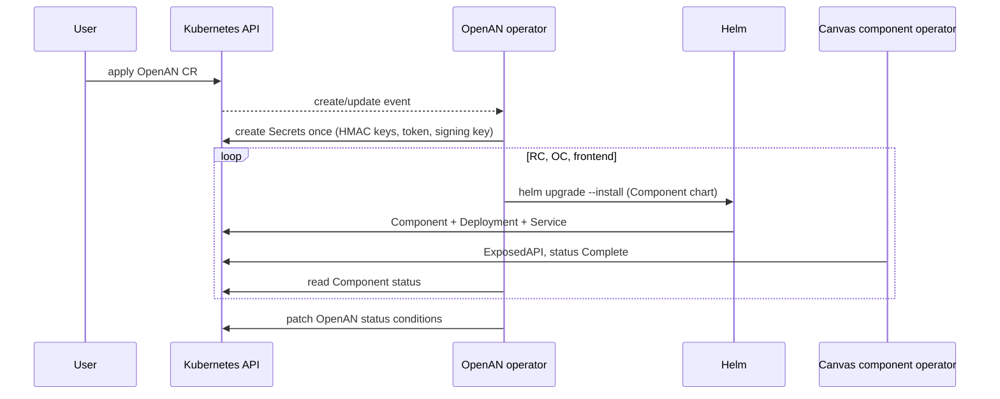
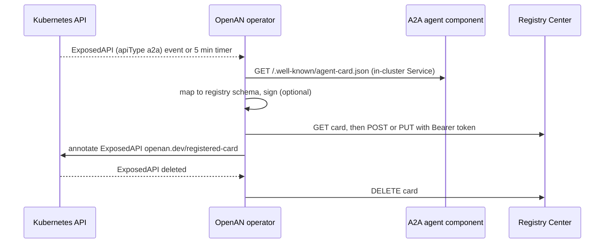

# OpenAN Operator

A Python/[kopf](https://kopf.readthedocs.io) operator for the [ODA Canvas](https://github.com/tmforum-oda/oda-canvas).
It lives outside the Canvas repository and has these jobs:

1. **Stack lifecycle** – an `OpenAN` custom resource (`openans.openan.dev/v1alpha1`) installs, upgrades and
   uninstalls the Registry Center, Orchestration Center and frontend. Each is an **ODA Component** with its own
   Helm chart (`charts/openan-registry-center`, `charts/openan-orchestration-center`, `charts/openan-frontend`)
   bundled in the operator image under `/charts`. The operator runs `helm upgrade --install` in order
   (RC → OC → frontend), gating each step on the Canvas reporting the Component `Complete`.
2. **Agent Card sync** – every Canvas `ExposedAPI` with `apiType: a2a` is fetched from the component's
   `/.well-known/agent-card.json`, mapped to the Registry Center schema, (optionally) signed with ES256 and
   upserted into the Registry Center. Deleting the ExposedAPI deletes the card.
3. **Agent sync** (opt-in, `spec.agentSync.enabled`) – agent registries found as ODA Components and Agent ODA
   Components are kept in step both ways: registry cards become Components, deletes propagate in both directions
   (see [Agent sync](#agent-sync-agent-registries---agent-oda-components)).
4. **Agent gateway routes** (opt-in, chart value `agentGateway.enabled`) – every a2a ExposedAPI, whether its agent
   was made in Kubernetes, deployed from a registry card or mirrors an external agent, gets an A2A route in
   [agentgateway](https://github.com/agentgateway/agentgateway) (see [Agent gateway routes](#agent-gateway-routes)).





## Layout

| Path | Purpose |
|---|---|
| `src/openan_operator.py` | kopf handlers |
| `src/stack.py`, `helm_driver.py`, `secrets_bootstrap.py` | lifecycle: values, Helm, Secrets (created once, never rotated) |
| `src/cards.py`, `card_mapper.py`, `card_signer.py`, `registry_client.py` | card sync |
| `src/agent_sync.py`, `agent_manifests.py` | agent sync, pure logic: registry discovery, plans, the rendered Component/Deployment/Service/ConfigMap |
| `src/agent_sync_io.py`, `registry_source.py` | agent sync, side effects: registry reads (native, TMF639), cluster writes, mirror release |
| `src/gateway_routes.py`, `gateway_io.py` | agentgateway routes: the wanted routes and how they merge into the config (pure); ConfigMap write, reload check |
| `crd/openan-crd.yaml` | CRD (copy kept in `charts/openan-operator/crds/`, checked by a contract test) |
| `Dockerfile` | build with `containerized/build/build-operator.sh` (context = repo root) |

## Operating notes and limits

- **Secrets** `<cr>-registry-runtime`, `-registry-credentials`, `-operator-token`, `-orchestration-runtime`,
  `-signing-key` are generated on first reconcile and are owned by the CR. The operator token is a
  `vendor_agent` Bearer token for the Registry Center (owner isolation: one stable identity).
- **Image tags** have no default: `spec.<component>.values.image.tag` is required.
- **Signing**: the Registry Center only accepts signed cards. The operator signs them (ES256) with the generated
  `-signing-key` Secret and publishes the public key in the trust ConfigMap `<cr>-registry-trust` that the Registry
  Center verifies against, so the kind demo needs no HTTPS `jku` endpoint (`spec.cardSync.signing.enabled: true`).
  The ConfigMap is created by the first successful card fetch (before the card is published), so it does not exist
  until an a2a ExposedAPI has been synced once; the Registry Center mounts it as optional and has no keys before that. After the ConfigMap is created the kubelet takes
  about a minute to sync it into the Registry pod, so the first publish can fail with `401 no valid signature with a
  trusted key`; the operator retries it and it then succeeds.
  Setting it to `false` disables signature validation in the Registry Center. Production should serve the keys from an
  HTTPS JWKS endpoint (`spec.cardSync.signing.jku`) with `REGISTRY_JWK_ALLOWLIST`.
- **Stuck Helm releases**: if an operator pod dies in the middle of `helm upgrade --install` (OOM, node drain, a second
  operator racing during a restart), Helm leaves the revision in `pending-install`/`pending-upgrade`/`pending-rollback` and
  refuses every later upgrade ("another operation (install/upgrade/rollback) is in progress"). Before each upgrade the
  operator checks the release history; a latest revision pending for longer than `HELM_PENDING_STALE_SECONDS` (default 150 s,
  never below 150 s: the `helm` timeout is 120 s, so a younger revision may belong to a live operation; set it through the
  chart's `configmap.extra`) is repaired:
  `helm rollback` to the last `deployed`/`superseded` revision, or, only for a first install that never completed
  (`pending-install`, revision 1; nothing to lose), `helm uninstall` so that the upgrade installs it afresh. A release that
  was installed before and has no good revision to go back to is **not** uninstalled (the Canvas adopts its data PVCs, so
  removing the Component would delete the data): the reconcile reports the error and retries until someone fixes or deletes
  the release. Each repair is logged (`openan.helm`, warning) and counted in
  `openan_operator_helm_recoveries_total{action="rolled-back"|"uninstalled"}`. A younger pending revision is left alone and
  the reconcile retries after 30 s.
- **What a CR may set:** Helm `values` per component are merged over the generated ones, except the Secret
  references, the trust store and the Registry/backend URLs, which are always the generated ones (credentials are
  sent to those URLs). `registry.extraEnv` / `orchestration.extraEnv` may not set auth, token or registry URL
  variables, and `image.repository` must start with an allowed prefix (default `ghcr.io/project-openan/`; override
  with the operator env `ALLOWED_IMAGE_PREFIXES`, comma separated, e.g. via `configmap.extra`). A violating CR is
  rejected before anything is installed. Using a Registry that is not the one the operator deploys is therefore
  not supported through this CR.
- **TMFC012 values (`registryCenter.values`):**
  - `tmf639.specificationUrl` must be a `tmf639-a2a-agent-v5.yaml` profile under an allowed prefix. The default
    prefix is `https://raw.githubusercontent.com/project-openan/registry-center/`; set the operator env
    `ALLOWED_SPEC_URL_PREFIXES` to override it.
  - `broadcast.callbackAllowlist` hosts must be listed in the operator env `ALLOWED_CALLBACK_HOSTS`. It is empty
    by default, so no hub or webhook destinations are allowed.
  - `broadcast.callbackCaConfigMap` (extra CAs for callback TLS) must be listed in the operator env
    `ALLOWED_CALLBACK_CA_CONFIGMAPS`, which is empty by default: an extra CA widens whom callbacks trust.
  - `broadcast.allowHttpCallbacks` and `catalog.specificationUrl` cannot be set from a CR.
  - `REGISTRY_TMF639_*`, `REGISTRY_BROADCAST_*` and `REGISTRY_PATH_PREFIX` (always `/<componentName>`, the Canvas
    gateway prefix) are generated keys, so a CR that set `REGISTRY_BROADCAST_ENABLED` in `registry.extraEnv` must
    move it to `broadcast.enabled`.
- Card sync uses the oldest `OpenAN` in the namespace that is Ready; the operator ships one namespaced Role per
  monitored namespace, so wildcard namespaces such as `odacompns-*` are watched but not managed.
- Only `a2a` ExposedAPIs are card-synced; the Registry Center has no MCP concept.
- The frontend component is optional (`spec.frontend.enabled`); the portal image has no published tag.
- Image user: published images differ (1000 vs 10001); override `values.podSecurityContext` per component.
- Helm runs inside the operator (Helm 3). `helm uninstall` keeps the data PVCs on purpose.

## Agent sync: agent registries <-> Agent ODA Components

Off by default; `spec.agentSync.enabled: true` on the OpenAN CR turns it on for that CR's namespace.

**Registries are ODA Components.** Every Resource Inventory Component (`componentMetadata.id` `TMFC012` or
`OPENAN-RC`) in the namespace whose ExposedAPI specification URL ends in `/registry-center.yaml` (or API name
`agentregistry`: the native Registry Center API, preferred) or `/tmf639-a2a-agent-v5.yaml` (TMF639 agent profile,
read-only) is synced. `TMFC012` or `TMF639` alone never match: generic inventories are not agent registries.
Registries in other namespaces are not discovered.

- The CR's own Registry Center uses operator-generated credentials. Enabling the sync adds a read-only `nms_oss`
  credential (identity `openan-operator-sync`, Secret `<cr>-sync-token`) to the existing credentials file and restarts
  the Registry Center once (pod annotation `checksum/credentials`). Writes keep using `openan-operator`.
- A **connected registry** running outside the cluster is a proxy Component: a Resource Inventory Component whose
  registry API is served by a small reverse proxy to the external URL (example:
  `oda_canvas/manifests/openan/connected-registry.yaml.tpl`, applied by `make connect-registry` in `oda_canvas/`; a
  registry whose API sits below a path, e.g. `/api/registry-center`, sets `CONNECTED_REGISTRY_PATH_PREFIX`, which the
  proxy adds upstream). Annotations on that Component:
  `openan.dev/credentials-secret` (Secret with `token` and optional `readToken`, labelled
  `openan.dev/registry-credentials=true` and annotated `openan.dev/registry-component: <that Component's name>` and
  `openan.dev/registry-endpoint: http://<implementation>.<namespace>.svc.cluster.local:<port>`, so a Secret is only
  ever sent to that registry at that endpoint; the operator refuses its own Secrets) and
  `openan.dev/agent-publish: "true"` (publish Kubernetes-made cards there; needs `cardSync.signing.jku`, an HTTPS key
  URL that registry trusts). Whether its cards may run images is operator configuration, not an annotation:
  `AGENT_DEPLOY_REGISTRIES` (comma-separated `<registry Component>=<endpoint>` pairs: a Component re-created or
  re-pointed under the same name does not inherit the trust).

**Registry -> Kubernetes.** Every 15 s the operator reads the change feed (`/changes`) and, when something changed or
every `AGENT_SYNC_RESYNC_SECONDS` (300), the complete card list. Each *published* card that was not published from
this cluster becomes an Agent ODA Component `<registry>-<agent>-<hash>` (label `openan.dev/origin=registry`, owned by
the registry Component, so it goes when the registry goes):

- **deploy**: the card carries the signed extension `https://openan.dev/extensions/deployment` with
  `{"v": 1, "image": "<allowed prefix>...:<tag>", "port": 8080, "path": "/a2a", "health": "/healthz", "replicas": 1}`
  (no env, command or volumes). Only for the CR's own registry with signing on, or a registry listed in
  `AGENT_DEPLOY_REGISTRIES`; the image must match `ALLOWED_IMAGE_PREFIXES`. The agent gets
  `A2A_RPC_PATHS=<path>,/<component>/a2a`, because the Canvas gateway forwards `/<component>/a2a` unchanged.
- **mirror**, otherwise: an nginx proxy (`AGENT_PROXY_IMAGE`, default `nginxinc/nginx-unprivileged:1.27-alpine`, pinned;
  it is operator configuration, not checked against the card image allow-list) forwards `/<component>/a2a` to the
  card's first interface URL, and serves the card at `/.well-known/agent-card.json` with that interface pointing at
  itself (`http://<component>.<namespace>.svc.cluster.local:8080/<component>/a2a`; other interfaces unchanged), so
  in-cluster clients and the agentgateway route go through the proxy. It resolves the host per request and is ready on its own `/healthz`, so a remote outage
  does not make the Component fail. Cluster-internal, private and link-local targets are refused unless listed in
  `AGENT_UPSTREAM_ALLOWED_HOSTS` (comma-separated host suffixes; when set, only those hosts are allowed). The check is
  on the URL: a public name that *resolves* to an internal address is not caught, so production should set
  `AGENT_UPSTREAM_ALLOWED_HOSTS` and/or an egress NetworkPolicy for pods labelled `openan.dev/origin=registry`.
  IP literals must be canonical (`127.0.0.01` or `0x7f.1` are refused: nginx would read them as `127.0.0.1`) and
  DNS names must end in an alphabetic top-level domain.

A card that is deleted, unpublished, rejected or deprecated removes its Component. A pass that would remove more than
half of a registry's Components (at least 5) is held until the next pass asks for the same removals. Each agent and
each removal is applied on its own: a card the cluster rejects (or that cannot be mirrored) is reported and skipped,
the others still sync, and the next tick runs a full pass again. An existing object with an agent's name that
the sync did not make (a Component without its labels, or a Deployment, Service or ConfigMap that Component does not
own) is never taken over: the agent is reported and skipped. Updates replace the Deployment, Service and ConfigMap
as a whole (a switch between deploy and mirror leaves nothing of the other mode behind); the spec hash is written on
the Component last, so a pass that failed half-way is redone.

**Kubernetes -> registry.** The card sync above, for Components made in the cluster; Components made from a registry
are never published back. Connected registries annotated `openan.dev/agent-publish: "true"` also get the card; the
ExposedAPI then carries `openan.dev/registered-cards` (`{"<registry id>": "<org>/<name>"}`) next to
`openan.dev/registered-card` (the CR's own registry).

**Deletes go both ways.**

| Deleted | Effect |
|---|---|
| card of a registry-made Component | Component (and its Deployment, Service, ConfigMap) deleted |
| registry-made Component (by a user) | card deleted in its registry first; if the registry refuses (card owned by another identity, read-only TMF639 registry) the Component stays `Terminating` with a warning and is retried every 60 s until the card is gone. Escape hatch: annotate it `openan.dev/operator-delete: "true"`. Only a Component owned by that registry Component, named after a currently published card and carrying the hash the operator rendered for it is acted on (labels and annotations alone are not trusted), and a card published from Kubernetes is never deleted this way. A mirror deleted right after its card changed (before the next pass re-rendered it) goes without its card and comes back; deleting it again deletes the card. Users who can create and delete Components in the namespace are trusted as much as for Kubernetes-made agents, whose deletion also deletes their cards |
| card of a Kubernetes-made Component | the Component is deleted, on an `AGENT_DEREGISTERED` event for a card its ExposedAPI had published and that is gone from the complete list (a review state change does not count). A Component with several a2a APIs goes only when all of their cards are gone. Opt out with `openan.dev/keep-on-card-delete: "true"` on the Component. Helm-installed agents come back on the next `helm upgrade`. The feed cursor is kept in the CR status (`status.agentSync.cursors`), so deletions made while the operator was down are replayed for as long as the registry keeps its events (7 days); card publishing waits for that first pass after a start, so a deleted card is not republished first |
| Kubernetes-made Component | card deleted (card sync) |
| registry Component | its registry-made Components are garbage-collected; cards are left alone |

**No loops.** Registry -> Kubernetes reads only cards without the signed `source-exposedapi` extension and writes only
Components labelled `openan.dev/origin=registry`; card sync reads only ExposedAPIs of Components without that label
and writes only cards with the extension. Writes are skipped when the rendered objects' hash
(`openan.dev/spec-hash`) is unchanged, deletes are idempotent, and the operator marks its own deletes
(`openan.dev/operator-delete`, cleared again if the delete fails) so they are not echoed to the registry.

**Operations.** The driver is a timer on the OpenAN CR, not on registry Components: kopf timers put a finalizer on
what they watch, and registry Components belong to Helm. The only Component handler is the delete handler,
label-filtered to registry-made Components (they keep `openan.dev/finalizer` while the operator is not running; remove
it by hand to delete them then). A registry that cannot be read completely (down, 401/403 while the Registry Center
restarts with the new credential) changes nothing and is reported once per outage. Turning the sync off stops it and
removes the `checksum/credentials` annotation (one more Registry Center restart); the sync credential, its Secret and
the Components it made are left in place. A registry whose event store is reset (versions start again below the
stored cursor) is still resynced every `AGENT_SYNC_RESYNC_SECONDS`, but deletions of Kubernetes-made agents in it are
only seen from events.

| Setting (operator env, chart `configmap.extra`) | Default | Meaning |
|---|---|---|
| `AGENT_PROXY_IMAGE` | `nginxinc/nginx-unprivileged:1.27-alpine` | mirror proxy image, pinned tag or digest |
| `AGENT_UPSTREAM_ALLOWED_HOSTS` | empty (any public host) | comma-separated host suffixes mirrors may proxy to |
| `AGENT_DEPLOY_REGISTRIES` | empty | `<registry Component>=<endpoint>` pairs of connected registries whose cards may run images |
| `AGENT_SYNC_RESYNC_SECONDS` | `300` | complete list of a native registry at least this often |
| `AGENT_SYNC_TMF639_SECONDS` | `60` | poll interval of TMF639-only registries (no change feed) |
| `ALLOWED_IMAGE_PREFIXES` | `ghcr.io/project-openan/` | also the allow-list of images a card may deploy |

| Annotation / label | On | Meaning |
|---|---|---|
| label `openan.dev/origin=registry` | Components made from a card (and their children) | made by agent sync; drives the delete handler |
| label `openan.dev/registry` | same | short hash of the source registry |
| label `app.kubernetes.io/managed-by=openan-operator` | same | |
| `openan.dev/source-registry`, `openan.dev/card-key` | same | `<namespace>/<registry Component>`, `<org>/<agent name>` |
| `openan.dev/spec-hash`, `openan.dev/mode` | same | hash of the rendered objects; `deploy` or `mirror` |
| `openan.dev/operator-delete` | same | delete without touching the card (set by the operator; escape hatch) |
| `openan.dev/keep-on-card-delete` | Kubernetes-made Components | keep the Component when its card is deleted |
| `openan.dev/registered-card`, `openan.dev/registered-cards` | ExposedAPIs | cards published from it (own registry; connected registries) |
| `openan.dev/credentials-secret`, `openan.dev/agent-publish` | connected registry Components | see above |
| label `openan.dev/registry-credentials=true`, `openan.dev/registry-component`, `openan.dev/registry-endpoint` | credentials Secrets | see above |

Metric `openan_operator_agent_sync_total{action,result}`: `created`/`updated`/`unchanged`/`mirror-deleted`/
`component-deleted` with `ok`; `read` with `unavailable` or `kubernetes-error`; `release` with `ok` or `refused`.

## Agent gateway routes

Off by default. With the chart value `agentGateway.enabled: true`, the operator keeps one A2A route per a2a
ExposedAPI in a standalone agentgateway (the Canvas `charts/agentgateway`), for every namespace with a Ready OpenAN CR
(the oldest one drives it; `spec.agentGateway.enabled: false` on that CR turns it off for its namespace). Agents made
in Kubernetes, deployed from a registry card and mirrors of external agents all have an a2a ExposedAPI, so the
registries' agents (internal and connected) reach the gateway through the agent sync above.

| Route field | Value |
|---|---|
| `name` | `openan.<namespace>.<ExposedAPI>` |
| path | `<AGENTGATEWAY_PATH_PREFIX>/<namespace>/<ExposedAPI>` (prefix match) |
| backend | `<implementation>.<namespace>.svc.cluster.local:<port>` of the ExposedAPI |
| policies | `a2a` (the gateway rewrites the card's interface URLs to itself), `urlRewrite` prefix `/`, 120 s timeout |

The agent card is then at `<path>/.well-known/agent-card.json` on the gateway. A mirror serves the registry's card with its
first interface URL pointing at the mirror (`http://<name>.<namespace>.svc.cluster.local:8080/<name>/a2a`), so the
gateway's rewrite leads to the proxy, not straight to the external URL.

**How it is written.** Standalone agentgateway has no write API: it reads one file, `config.yaml` in the ConfigMap
`AGENTGATEWAY_CONFIG_MAP`, and reloads it when it changes; its port 8081 serves `/config_dump` and `/api/runtime`
for reading only (the admin port is loopback-only). Every 15 s the operator:

1. lists the namespace's a2a ExposedAPIs and their Components (an ExposedAPI of a missing or terminating Component,
   one whose implementation is not a DNS label, or one with a `gatewayConfiguration` (API key
   verification, rate limits: policies the route would not enforce) gets no route);
2. reads the file and replaces only the routes named `openan.<namespace>.*` in the top-level `routes` list. Everything
   else (models, MCP targets, routes from Helm or the Canvas Portal, other namespaces' routes) stays as it is. A route whose path, or a path below it,
   is served by another route is left out with a warning (the gateway picks the longest prefix);
3. writes it only if it changed, with the `resourceVersion` it read: a concurrent change answers 409 and the next pass
   starts again from the new file;
4. checks on the next passes, on port 8081 with the key in `AGENTGATEWAY_KEY_SECRET`, that the gateway loaded the
   routes. The kubelet takes up to about a minute to update the file in the pod. A file the gateway rejects keeps
   the old config running but would stop a restarted pod, so it is put back (if nobody wrote after it) and the same
   routes are not written again until they change. No second write is made while one waits, for at most 180 s.

A route goes when its ExposedAPI goes. `helm upgrade` of the gateway (`make agentgateway`) puts back the chart's
`routes`; the next pass adds the operator's routes again. A missing ConfigMap is reported once and changes nothing;
the gateway never affects the card or agent sync. Turning it off (chart value or `spec.agentGateway.enabled: false`) or
deleting the CR stops the sync and leaves the `openan.<namespace>.*` routes in place; remove them from the ConfigMap
by hand, or re-run `helm upgrade` of the gateway.

| Setting (operator env; the chart renders them from `agentGateway.*`) | Default | Meaning |
|---|---|---|
| `AGENTGATEWAY_NAMESPACE` | empty (off) | namespace of the gateway's ConfigMap and key Secret |
| `AGENTGATEWAY_CONFIG_MAP` | `agentgateway-config` | ConfigMap with `config.yaml` |
| `AGENTGATEWAY_KEY_SECRET` | `agentgateway-portal-key` | Secret (`key`) for port 8081 |
| `AGENTGATEWAY_CONFIG_URL` | `http://agentgateway.<namespace>.svc.cluster.local:8081` | read port |
| `AGENTGATEWAY_GATEWAY` | `default` | `gateways:` of the routes |
| `AGENTGATEWAY_PATH_PREFIX` | `/agents` | first path segment(s) of the routes |
| `AGENTGATEWAY_PUBLISH_URL` | empty (off) | base URL of the gateway's traffic port; when set, published cards advertise the gateway route (below) |

**Cards with the gateway URL (opt-in).** By default the card sync publishes the agent's own URL. Only when
`AGENTGATEWAY_PUBLISH_URL` is set (and the routes above are on for the namespace and the ExposedAPI gets a route)
does it replace every interface URL on the agent's own Service with
`<AGENTGATEWAY_PUBLISH_URL><AGENTGATEWAY_PATH_PREFIX>/<namespace>/<ExposedAPI><original path>`, before signing; this
applies to the CR's own registry and to connected registries with `openan.dev/agent-publish`. Interfaces on other hosts
(the Canvas gateway URL) are kept. Cards are republished on the next card sync (on start and every 5 min), so
setting or clearing it takes effect without other changes.

RBAC: a Role in `AGENTGATEWAY_NAMESPACE` with `get`/`patch` on that one ConfigMap and `get` on that one Secret
(`resourceNames`). Metric `openan_operator_gateway_routes_total{action,result}`: `written` with `ok` or `rejected`,
`read` with `unavailable`, `write` with `kubernetes-error`.

## Develop

```bash
pip install -r operator/openan-operator/requirements.txt pytest
python -m pytest operator/openan-operator/tests -q
bash containerized/build/build-operator.sh --tag 0.1.0
```

Kind demo: `make -C oda_canvas openan-operator-image openan-operator openan-sample`.
