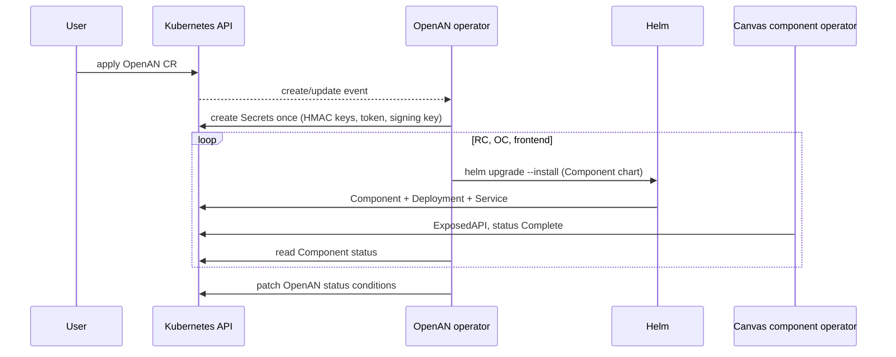
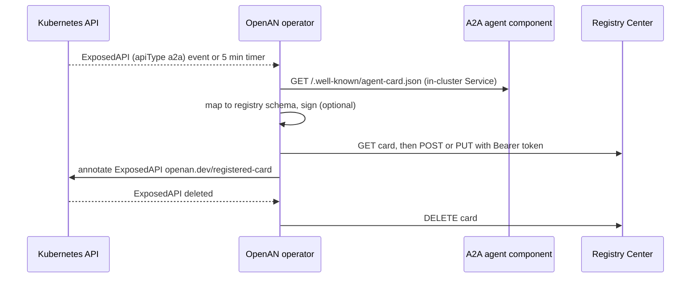

# OpenAN Operator

A Python/[kopf](https://kopf.readthedocs.io) operator for the [ODA Canvas](https://github.com/tmforum-oda/oda-canvas).
It lives outside the Canvas repository and has two jobs:

1. **Stack lifecycle** – an `OpenAN` custom resource (`openans.openan.dev/v1alpha1`) installs, upgrades and
   uninstalls the Registry Center, Orchestration Center and frontend. Each is an **ODA Component** with its own
   Helm chart (`charts/openan-registry-center`, `charts/openan-orchestration-center`, `charts/openan-frontend`)
   bundled in the operator image under `/charts`. The operator runs `helm upgrade --install` in order
   (RC → OC → frontend), gating each step on the Canvas reporting the Component `Complete`.
2. **Agent Card sync** – every Canvas `ExposedAPI` with `apiType: a2a` is fetched from the component's
   `/.well-known/agent-card.json`, mapped to the Registry Center schema, (optionally) signed with ES256 and
   upserted into the Registry Center. Deleting the ExposedAPI deletes the card.





## Layout

| Path | Purpose |
|---|---|
| `src/openan_operator.py` | kopf handlers |
| `src/stack.py`, `helm_driver.py`, `secrets_bootstrap.py` | lifecycle: values, Helm, Secrets (created once, never rotated) |
| `src/cards.py`, `card_mapper.py`, `card_signer.py`, `registry_client.py` | card sync |
| `crd/openan-crd.yaml` | CRD (copy kept in `charts/openan-operator/crds/`, checked by a contract test) |
| `Dockerfile` | build with `containerized/build/build-operator.sh` (context = repo root) |

## Operating notes and limits

- **Secrets** `<cr>-registry-runtime`, `-registry-credentials`, `-operator-token`, `-orchestration-runtime`,
  `-signing-key` are generated on first reconcile and are owned by the CR. The operator token is a
  `vendor_agent` Bearer token for the Registry Center (owner isolation: one stable identity).
- **Image tags** have no default: `spec.<component>.values.image.tag` is required.
- **Signing**: the Registry Center only accepts signed cards. The operator signs them (ES256) with the generated
  `-signing-key` Secret and publishes the public key in the trust ConfigMap `<cr>-registry-trust` that the Registry
  Center verifies against, so the kind demo needs no HTTPS `jku` endpoint (`spec.cardSync.signing.enabled: true`).
  The ConfigMap is created by the first successful card fetch (before the card is published), so it does not exist
  until an a2a ExposedAPI has been synced once; the Registry Center mounts it as optional and has no keys before that.
  Setting it to `false` disables signature validation in the Registry Center. Production should serve the keys from an
  HTTPS JWKS endpoint (`spec.cardSync.signing.jku`) with `REGISTRY_JWK_ALLOWLIST`.
- **What a CR may set:** Helm `values` per component are merged over the generated ones, except the Secret
  references, the trust store and the Registry/backend URLs, which are always the generated ones (credentials are
  sent to those URLs). `registry.extraEnv` / `orchestration.extraEnv` may not set auth, token or registry URL
  variables, and `image.repository` must start with an allowed prefix (default `ghcr.io/project-openan/`; override
  with the operator env `ALLOWED_IMAGE_PREFIXES`, comma separated, e.g. via `configmap.extra`). A violating CR is
  rejected before anything is installed. Using a Registry that is not the one the operator deploys is therefore
  not supported through this CR.
- Card sync uses the oldest `OpenAN` in the namespace that is Ready; the operator ships one namespaced Role per
  monitored namespace, so wildcard namespaces such as `odacompns-*` are watched but not managed.
- Only `a2a` ExposedAPIs are synced; the Registry Center has no MCP concept.
- The frontend component is optional (`spec.frontend.enabled`); the portal image has no published tag.
- Image user: published images differ (1000 vs 10001); override `values.podSecurityContext` per component.
- Helm runs inside the operator (Helm 3). `helm uninstall` keeps the data PVCs on purpose.

## Develop

```bash
pip install -r operator/openan-operator/requirements.txt pytest
python -m pytest operator/openan-operator/tests -q
bash containerized/build/build-operator.sh --tag 0.1.0
```

Kind demo: `make -C oda_canvas openan-operator-image openan-operator openan-sample`.
